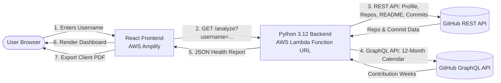

# GitHub Health Analyzer

[](https://react.dev/)
[](https://www.python.org/)
[](https://aws.amazon.com/)
[](LICENSE)

A lightweight single-page web application designed for students and developers to evaluate and showcase their GitHub development activity, repository maintenance hygiene, and contribution consistency over the previous 12 months.

---

## Live Demo

**[Launch GitHub Health Analyzer &rarr;](https://main.d3a25s683fgxyw.amplifyapp.com)**

Deployed on **AWS Amplify Hosting** with a serverless **AWS Lambda** backend.

---

## Project Overview

GitHub Health Analyzer provides a clean snapshot of any publicly accessible GitHub profile. By synthesizing signals from the official GitHub REST and GraphQL APIs, the application evaluates:
- 12-month rolling contribution activity and active weekly consistency.
- Primary programming language distribution across original projects.
- Repository documentation and maintenance signals (README existence, commit depth, and push recency).
- Instant, client-side downloadable PDF reports for resumes and portfolio reviews.

The tool requires no login, collects no user credentials, uses no database, and analyzes public data only.

---

## Features

- **GitHub Profile Analysis**: Instant retrieval of avatar, bio, follower count, public repository count, and account creation year using just a username.
- **12-Month Contribution Statistics**: Total public contributions and active weekly consistency over the preceding 52–53 weeks.
- **Monthly Contribution Graphs**: Interactive Recharts bar chart showing month-by-month contribution volume in chronological order.
- **Contribution Heatmap**: GitHub-style calendar heatmap visualizing 365+ days of activity.
- **Programming Language Distribution**: Horizontal bar chart of the top 5 primary programming languages across original public repositories.
- **Repository Analysis**: Structured evaluation of up to 10 most recently updated original public repositories (forks and empty repositories excluded).
- **Commit Count Analysis**: Server-side commit counting on default branches using efficient `Link` header pagination without downloading full commit histories.
- **Activity Rating**: Standardized tier rating (**Good**, **Very Good**, **Excellent**) derived from active weeks.
- **Personalized Improvement Suggestions**: Deterministic, rule-based recommendations tailored to detected documentation gaps or activity patterns.
- **Downloadable PDF Reports**: In-browser PDF generation via jsPDF and jspdf-autotable with formatted summary metrics, tables, and methodology disclaimers.

---

## Repository Rating Methodology

The repository analysis assesses basic maintenance hygiene and development activity across up to 10 selected original repositories. Each repository is evaluated against three objective signals:

| Signal | Evaluation Criterion | Points |
| :--- | :--- | :---: |
| **README** | Repository contains a verified, accessible README file | **+1** |
| **Recent Activity (<180d)** | Repository received a push within the last 180 days | **+1** |
| **Commits (≥10)** | Default branch has at least 10 recorded commits | **+1** |

### Rating Tiers

| Total Points | Rating | Description |
| :---: | :---: | :--- |
| **3** | **Excellent** | Project is documented, recently maintained, and demonstrates committed progress. |
| **2** | **Very Good** | Project satisfies two of the three maintenance criteria. |
| **0 – 1** | **Good** | Initial setup; project would benefit from updated documentation or commits. |
| **N/A** | **Not evaluated** | Displayed if GitHub API rate limits or upstream errors prevented signal verification. |

> **Note on Evaluation**: These signals reflect basic repository hygiene and maintenance cadence. They do not evaluate internal source-code quality, software architecture, or algorithmic proficiency.

---

## Activity Rating

The overall Activity Rating measures consistent public GitHub engagement across the 12-month rolling evaluation window. An active week is defined as a calendar week containing at least one public contribution.

| Active Weeks (of ~53) | Rating | Interpretation |
| :---: | :---: | :--- |
| **35 – 53 weeks** | **Excellent** | Consistent, frequent public development habit throughout the year. |
| **18 – 34 weeks** | **Very Good** | Moderate development activity across semesters or terms. |
| **0 – 17 weeks** | **Good** | Periodic or project-based public contributions. |

*Note: Work in private repositories, offline development, and contributions to private organizations with restricted visibility are not reflected.*

---

## Technology Stack

### Frontend
- **Framework**: React 18
- **Build Tool**: Vite
- **Language**: JavaScript (ES Modules)
- **Styling**: Plain CSS with custom CSS variables ("Slate & Sage" theme)
- **Data Visualization**: Recharts
- **PDF Generation**: jsPDF & jspdf-autotable (100% client-side)

### Backend
- **Runtime**: Python 3.12 (AWS Lambda)
- **Dependencies**: 100% Python Standard Library (`urllib.request`, `json`, `datetime`, `re`)
- **APIs**: GitHub REST API v3 & GitHub GraphQL API v4
- **Local Testing**: Standard library `http.server`

### Hosting & Infrastructure
- **Frontend Hosting**: AWS Amplify Hosting (continuous deployment from GitHub)
- **Backend Compute**: AWS Lambda Function URL (serverless HTTP endpoint with CORS protection)

---

## System Architecture



---

## Screenshots

<!-- Place actual screenshots in docs/screenshots/ with the filenames below -->

### Profile Summary & Activity Statistics

*Displays user avatar, bio, follower count, and primary statistics cards.*

### Contribution Visualizations

*12-month monthly contribution bar chart and 52-week calendar heatmap.*

### Repository Analysis Table

*Repository breakdown showing primary languages, stars, commit counts, signals, and ratings.*

---

## Local Installation

### Prerequisites
- **Node.js**: v18 or newer (v20+ recommended)
- **Python**: 3.11 or 3.12
- **Git**

### 1. Clone the Repository
```bash
git clone https://github.com/Amish-Sudhakara/GitHub-Health-Analyzer.git
cd GitHub-Health-Analyzer
```

### 2. Configure Environment Variables Securely
Create a `.env` file in the project root:
```ini
GITHUB_TOKEN=your_personal_access_token_here
```
*(The backend's `local_server.py` automatically reads this file on startup. `.env` is strictly ignored by `.gitignore` and is never committed).*

> **Token Permissions**: A personal access token with read-only public access increases your GitHub API rate limit from 60 to 5,000 requests/hour and enables GraphQL contribution calendar retrieval.

### 3. Install Frontend Dependencies
```bash
cd frontend
npm install
```

### 4. Run the Local Backend
In your first terminal (from project root):
```bash
python backend/local_server.py
```
*The local server starts on `http://localhost:8000`.*

### 5. Run the React Frontend
In a second terminal:
```bash
cd frontend
npm run dev
```
*The Vite development server will start at `http://localhost:5173`.*

### 6. Open the Application
Navigate to `http://localhost:5173` in your browser. Enter any public GitHub username (e.g., `octocat` or `Amish-Sudhakara`) to test the analysis.

---

## AWS Deployment

The project is deployed using a decoupled serverless architecture:

1. **Frontend**: Connected directly from this GitHub repository to **AWS Amplify Hosting** with automatic builds on push to `main` (configured via [amplify.yml](amplify.yml)).
2. **Backend**: Deployed as an **AWS Lambda** function running Python 3.12 with an unauthenticated Lambda Function URL and CORS restrictions configured for the Amplify domain.

For the comprehensive, step-by-step deployment guide including cost controls, AWS Budgets, and concurrency limits, see **[DEPLOYMENT.md](DEPLOYMENT.md)**.

---

## Limitations

- **Public Data Only**: The analyzer queries official public GitHub APIs. Activity in private repositories and organizations with restricted visibility cannot be assessed.
- **Scope Limit**: Repository analysis is bounded to the 10 most recently updated original public repositories to maintain fast response times and conserve API quotas.
- **Hygiene Signals vs. Code Quality**: Ratings evaluate project documentation, commit cadence, and push recency. They do not measure code efficiency, architectural complexity, or algorithmic capability.
- **API Rate Limits**: Unauthenticated requests to GitHub are restricted to 60 requests/hour per IP. Deployed instances require a backend token (`GITHUB_TOKEN`) to support consistent multi-user traffic.

---

## License

This project is licensed under the [MIT License](LICENSE).
